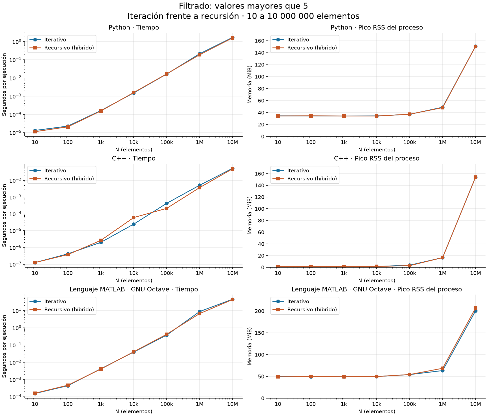
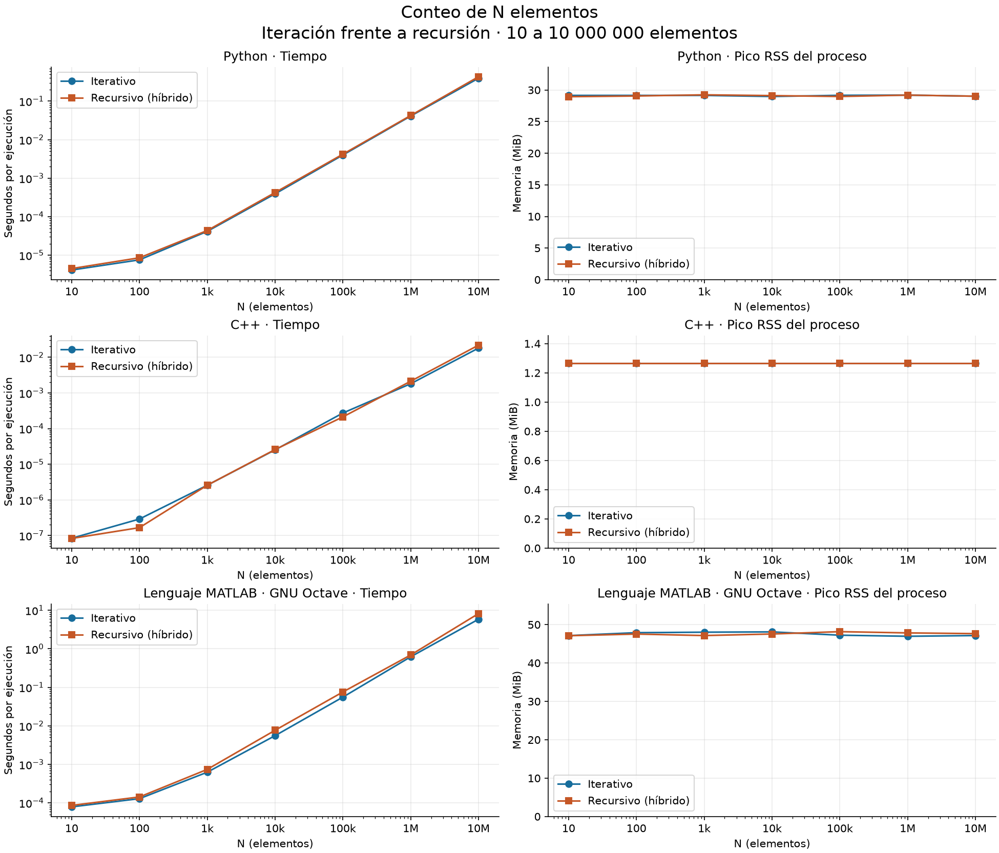
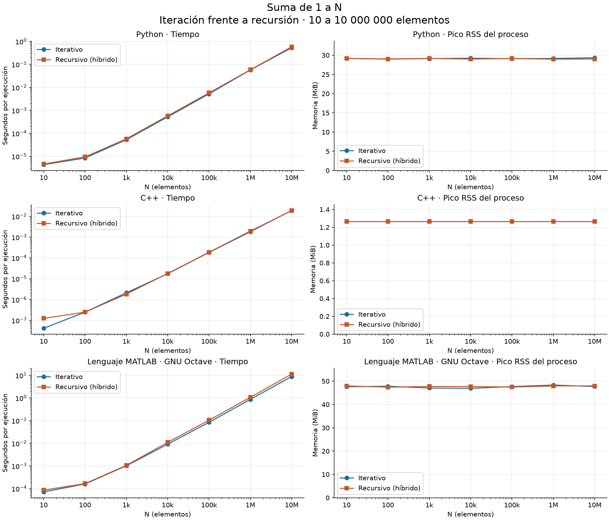
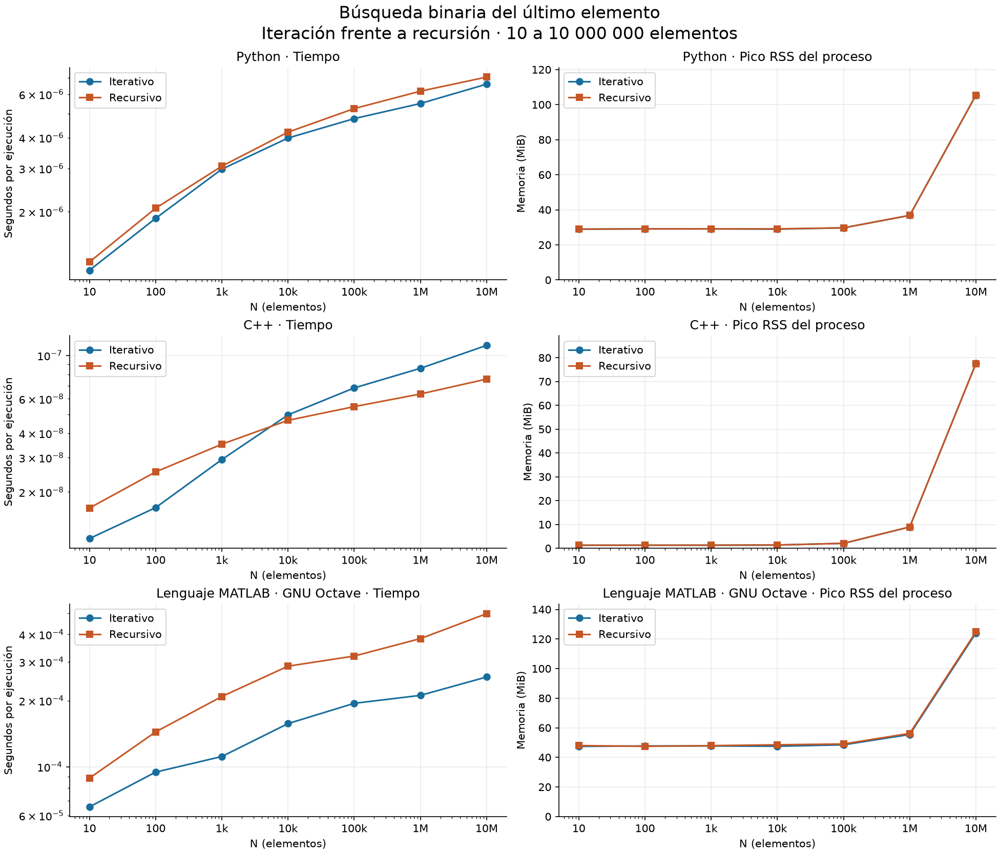
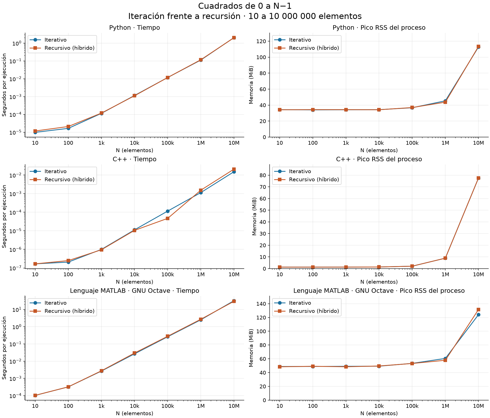
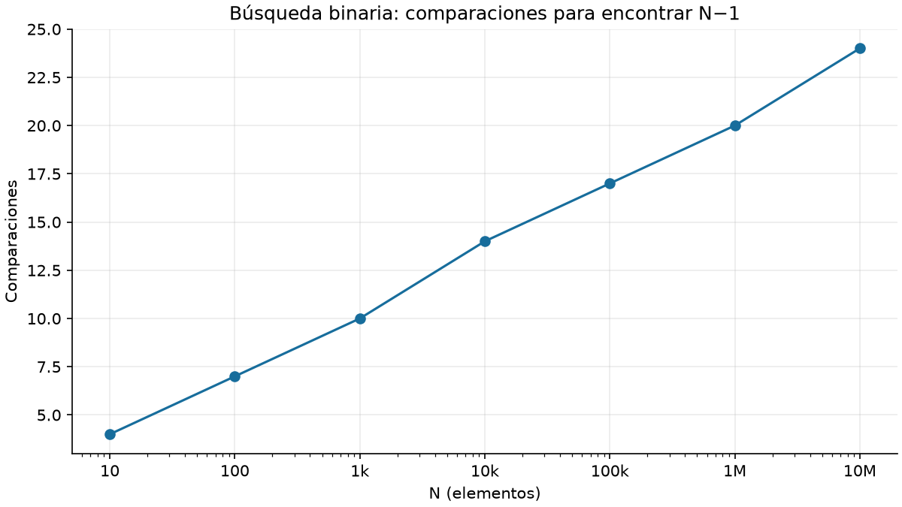

# Tarea 3 — Procesamiento iterativo frente a recursivo

## Objetivo y alcance
Comparar implementaciones **iterativas y recursivas** en **Python, C++ y lenguaje MATLAB**, para N = **10, 100, 1 000, 10 000, 100 000, 1 000 000 y 10 000 000**. Aquí N representa elementos o pasos lógicos, no puntos geométricos: esta tarea usa los ejemplos de la Semana 2, no las distancias de Tarea2.

Se registraron **210 casos**, **210 correctos**, y **534 mediciones de tiempo**. Cada caso es una combinación de lenguaje, algoritmo, método y tamaño. Las tablas y gráficas proceden de los CSV adjuntos.

**Entorno del archivo `.m`:** se utilizó GNU Octave. Es código de lenguaje MATLAB ejecutado en Octave; **no son mediciones del producto MATLAB**. El orquestador permite sustituirlo por MATLAB mediante `--matlab`.

## 1. Relación con el notebook proporcionado
Fuente: `Semana 2 - Ejemplos Python.ipynb`. Se conservaron las operaciones que ilustran los ejemplos y se añadió el método que faltaba para compararlas.

| Ejemplos del notebook | Adaptación en esta entrega |
|---|---|
| Ejercicio 1: filtrar valores mayores que 5 | Filtrado iterativo y recorrido recursivo, conservando el orden |
| Ejercicio 4: contar recursivamente | Contar N pasos; se omite imprimir cada nivel para medir cálculo |
| Ejercicios 5 y 17: suma normal y de cola | Suma iterativa y recursiva por intervalos; se conserva además el diagnóstico de las funciones lineales originales |
| Ejercicios 6, 7 y 9: búsqueda binaria y comparaciones | Búsqueda iterativa y recursiva pura; contador de comparaciones |
| Ejercicios 10, 11 y 13: cuadrados | Cuadrados iterativos y recursivos; no se compara NumPy vectorizado porque ahora se pide iteración frente a recursión |
| Ejercicios 14–16: memoria y visualización | Pico RSS por proceso independiente y gráficas de tiempo y memoria |
| Ejercicio 2: listas y diccionarios heterogéneos | Contexto de representación; no es por sí mismo un algoritmo de recorrido que se pueda cronometrar para N elementos |

## 2. Datos y resultados que se calculan
- **Filtrado:** se repite `[2,3,4,5,6,7,8,9]` hasta N elementos y se conservan los valores `>5`. Para N=10, el resultado es `[6,7,8,9]`. Se reserva capacidad para N resultados; solo el prefijo de longitud `usados` contiene valores válidos. No se oculta esa reserva al medir memoria.
- **Conteo:** se incrementa un acumulador N veces y se obtiene N. Se eliminan las impresiones por elemento.
- **Suma:** se calcula `1+2+…+N`. Se valida contra `N*(N+1)/2`, pero **esa fórmula no reemplaza el algoritmo cronometrado**.
- **Búsqueda:** se utiliza el arreglo ordenado `[0,1,…,N−1]` y se busca el último elemento. El índice devuelto es N−1 en los tres programas; MATLAB convierte los índices internos de cero a uno al acceder al arreglo.
- **Cuadrados:** se genera un arreglo con `0²,1²,…,(N−1)²`. El resultado completo se valida por bloques.

Se utilizan arreglos `float64`/`double` para las entradas y salidas numéricas; los índices son enteros. Los valores y sumas del experimento son enteros representables exactamente en double. Los tres lenguajes generan los mismos datos deterministas, sin depender de generadores aleatorios ni de semillas distintas. En Octave la entrada de búsqueda se materializa explícitamente en un arreglo double; se evita que `0:N-1` quede almacenado como un rango compacto. No se almacena un archivo gigante de entrada innecesario.

## 3. Cómo se construyeron las dos versiones
### Versión iterativa
Un `for` procesa cada elemento y actualiza el resultado. La búsqueda binaria usa `while` y reduce el intervalo hasta encontrar el objetivo o dejarlo vacío. Los arreglos de salida se reservan dentro del cálculo; crear la entrada queda fuera del cronómetro.

### Versión recursiva de búsqueda binaria
Conserva la estructura del notebook: intervalo vacío como caso base, comparación con el elemento central y llamada recursiva sobre una mitad. No se copian subarreglos: se pasan índices. La profundidad es O(log N), alrededor de 24 niveles para diez millones de elementos.

### Versión recursiva de los otros recorridos: híbrida
Para filtrado, conteo, suma y cuadrados se divide `[inicio,fin)` en dos mitades. El **caso base es un bloque de hasta 256 elementos**, procesado con el mismo bucle escalar usado por la versión iterativa. Las llamadas recorren primero la mitad izquierda y luego la derecha; la salida es compartida y se conserva el orden.

```text
recorrer(inicio, fin):
    si fin - inicio <= 256:
        procesar_escalarmente(inicio, fin)
        regresar
    medio = (inicio + fin) // 2
    recorrer(inicio, medio)
    recorrer(medio, fin)
```

**Esta es recursión híbrida, no recursión lineal ni una versión totalmente recursiva por elemento.** Para N=10 y N=100 se entra directamente en el caso base y no hay subdivisión; eso explica que esos puntos midan sobre todo el mismo bucle y los costos de llamada. Para N=10 000 000, la profundidad de `recorrer` es 17 niveles; hay hasta 65 536 hojas, sin millones de llamadas anidadas. El umbral 256 permanece fijo en los tres lenguajes.

Este cambio permite completar los tamaños pedidos con una pila acotada y sin aumentar artificialmente los límites de recursión. Ambos métodos conservan las operaciones escalares; la diferencia medida incluye la administración de intervalos y llamadas recursivas. No se usa vectorización para acelerar solo uno de los dos métodos.

## 4. Qué pasa con la recursión lineal original
`suma_lineal(n)` llama a `suma_lineal(n-1)`; `suma_cola` y el conteo lineal también requieren profundidad O(N) si no hay eliminación de llamadas de cola. En Python, no se aumentó el límite de recursión. Se ejecutó el diagnóstico adjunto y se registraron los fallos como fallos, no como cálculos rápidos de diez millones de elementos.

| Función Python | N | Estado |
|---|---:|---|
| suma_lineal | 10 | correcto |
| suma_lineal | 100 | correcto |
| suma_lineal | 1,000 | RecursionError: no resuelve este tamaño |
| suma_lineal | 10,000 | RecursionError: no resuelve este tamaño |
| suma_lineal | 100,000 | RecursionError: no resuelve este tamaño |
| suma_lineal | 1,000,000 | RecursionError: no resuelve este tamaño |
| suma_lineal | 10,000,000 | RecursionError: no resuelve este tamaño |
| suma_cola | 10 | correcto |
| suma_cola | 100 | correcto |
| suma_cola | 1,000 | RecursionError: no resuelve este tamaño |
| suma_cola | 10,000 | RecursionError: no resuelve este tamaño |
| suma_cola | 100,000 | RecursionError: no resuelve este tamaño |
| suma_cola | 1,000,000 | RecursionError: no resuelve este tamaño |
| suma_cola | 10,000,000 | RecursionError: no resuelve este tamaño |
| conteo_lineal | 10 | correcto |
| conteo_lineal | 100 | correcto |
| conteo_lineal | 1,000 | RecursionError: no resuelve este tamaño |
| conteo_lineal | 10,000 | RecursionError: no resuelve este tamaño |
| conteo_lineal | 100,000 | RecursionError: no resuelve este tamaño |
| conteo_lineal | 1,000,000 | RecursionError: no resuelve este tamaño |
| conteo_lineal | 10,000,000 | RecursionError: no resuelve este tamaño |

Las tres funciones lineales están incluidas también en C++ y MATLAB como ejemplos didácticos y se prueban con N=10. **No se ejecutaron a diez millones de niveles en esos lenguajes**: no se presentan tiempos ficticios ni se provoca deliberadamente un desbordamiento de pila. Los gráficos principales corresponden a las variantes recursivas descritas arriba.

## 5. Método de cronometraje
- Cada combinación de lenguaje, algoritmo, método y N se ejecuta en un **proceso nuevo**, de forma secuencial. El orden iterativo/recursivo alterna entre tamaños.
- Se realiza un calentamiento pequeño, de hasta 10 elementos, fuera del tiempo medido. No es un calentamiento completo del tamaño grande; esto debe tenerse en cuenta al interpretar cachés y asignadores.
- Se usa `perf_counter` en Python, `steady_clock` en C++ y `tic/toc` en MATLAB/Octave.
- Para los recorridos hay **3 mediciones hasta N=100 000** y **1 medición para N=1 000 000 y N=10 000 000**. La columna conserva el número real de repeticiones. Cuando hay una sola medición, la “mediana” es esa observación, sin estimación de variabilidad.
- La búsqueda es muy breve: cada medición cronometra **1 000 búsquedas** del mismo objetivo y divide el tiempo entre 1 000. Se realizan tres lotes para todos los tamaños. El CSV registra ese lote; los tiempos son **por búsqueda**, con caché caliente en la mayor parte del lote.
- Se incluye la reserva de la salida y el cálculo. Se excluyen la generación de entradas, el arranque del proceso, las comprobaciones y la escritura de archivos. El cronómetro externo del proceso se conserva aparte en el registro, pero no se confunde con el tiempo del algoritmo.
- C++ se compila con `-O2 -fno-optimize-sibling-calls`, sin `-ffast-math`. Se evita la eliminación de llamadas de cola para conservar la estructura recursiva y se utiliza el resultado para impedir su eliminación por no usarse.

## 6. Cómo se midió la memoria
Se registró **el pico de memoria residente (RSS) del proceso hijo** mediante `wait4`, convirtiendo las unidades del sistema operativo a bytes. Las gráficas lo expresan en **MiB = bytes / 1 048 576**.

Esta medición incluye **intérprete/bibliotecas, entrada, salida, pila, temporales, validación y todas las repeticiones de ese caso**. Es un pico del proceso completo, no la memoria incremental exclusiva de la función ni el tamaño exacto de cada marco recursivo. Python reserva la salida con `np.empty`; C++ y MATLAB/Octave inicializan su reserva con ceros. En el filtrado solo se utiliza un prefijo del búfer. La capacidad lógica reservada no implica que todas sus páginas estén residentes, y esa diferencia de asignación también puede influir en el RSS. Un proceso nuevo evita arrastrar picos de otros tamaños, pero la memoria de distintas ejecuciones todavía puede variar por carga de bibliotecas, asignadores y sistema operativo.

Por eso no se debe concluir que un algoritmo “necesita” todo el RSS del intérprete. Las pequeñas diferencias entre métodos pueden ser ruido. La búsqueda tiene entrada O(N), aunque la memoria auxiliar de su algoritmo sea O(1) iterativa y O(log N) recursiva. La memoria del arreglo puede ocultar esa diferencia de pila.

El CSV también incluye **bytes lógicos de entrada y capacidad de salida**, calculados exactamente a partir de N y double de 8 bytes. Esos tamaños son contabilidad de datos, no otra medición de RSS. Para diez millones:

| Algoritmo | Entrada | Capacidad de salida | Datos numéricos totales |
|---|---:|---:|---:|
| Filtrado | 80 000 000 bytes | 80 000 000 bytes | 152.59 MiB |
| Búsqueda | 80 000 000 bytes | resultado escalar | 76.29 MiB más escalar |
| Cuadrados | sin arreglo de entrada | 80 000 000 bytes | 76.29 MiB |
| Conteo y suma | N escalar | resultado escalar | O(1), además de la pila |

No se utiliza `sys.getsizeof(lista)` como si incluyera los objetos de todos sus elementos. Tampoco se comparan mediciones de `tracemalloc` de Python con RSS de otro lenguaje como si fueran la misma magnitud.

## 7. Validación
Antes de medir, los tres programas prueban los tamaños 0, 1, 8, 10 y 257, cubriendo datos vacíos y una subdivisión recursiva. La búsqueda prueba elementos primero, intermedio y último, y objetivos ausentes por debajo, dentro y por encima del rango. Las funciones lineales se prueban con resultados conocidos.

Después de cada medición se validan conteos, sumas e índices; filtrado y cuadrados se comprueban completos, no solo con una muestra. Las comprobaciones quedan fuera del tiempo medido, pero sí forman parte del proceso cuya memoria máxima se registra. Un error detiene el orquestador y deja el registro para poder diagnosticarlo.

## 8. Resultados: tiempos y memoria
Tiempos en **segundos por ejecución**; memoria en **MiB de RSS máximo del proceso**. `Rep.` es el número de mediciones temporales por método. La recursión de búsqueda es pura; las otras cuatro son híbridas.

### Filtrado: valores mayores que 5

| Lenguaje / entorno | N | Rep. | Tiempo iterativo (s) | Tiempo recursivo (s) | RSS iterativo (MiB) | RSS recursivo (MiB) |
|---|---:|---:|---:|---:|---:|---:|
| Python | 10 | 3 | 1.3040999e-05 | 1.1167e-05 | 34.27 | 34.11 |
| Python | 100 | 3 | 2.2667e-05 | 2.0625001e-05 | 34.16 | 34.38 |
| Python | 1,000 | 3 | 0.000160334 | 0.000152542 | 34.00 | 34.05 |
| Python | 10,000 | 3 | 0.001507542 | 0.001570833 | 34.22 | 34.05 |
| Python | 100,000 | 3 | 0.01627175 | 0.016627084 | 36.92 | 37.06 |
| Python | 1,000,000 | 1 | 0.21179508 | 0.18659933 | 48.75 | 48.05 |
| Python | 10,000,000 | 1 | 1.6683986 | 1.569407 | 150.66 | 150.47 |
| C++ | 10 | 3 | 1.25e-07 | 1.25e-07 | 1.27 | 1.27 |
| C++ | 100 | 3 | 4.16e-07 | 3.75e-07 | 1.27 | 1.27 |
| C++ | 1,000 | 3 | 2e-06 | 2.625e-06 | 1.30 | 1.31 |
| C++ | 10,000 | 3 | 2.4416e-05 | 6.025e-05 | 1.45 | 1.55 |
| C++ | 100,000 | 3 | 0.000423167 | 0.000212167 | 3.61 | 2.83 |
| C++ | 1,000,000 | 1 | 0.00506475 | 0.003651667 | 16.59 | 16.58 |
| C++ | 10,000,000 | 1 | 0.051405625 | 0.048089791 | 153.91 | 153.91 |
| Lenguaje MATLAB · GNU Octave | 10 | 3 | 0.00015497208 | 0.00016093254 | 49.91 | 49.05 |
| Lenguaje MATLAB · GNU Octave | 100 | 3 | 0.00043797493 | 0.00046801567 | 49.20 | 49.66 |
| Lenguaje MATLAB · GNU Octave | 1,000 | 3 | 0.0041799545 | 0.0040130615 | 49.20 | 49.28 |
| Lenguaje MATLAB · GNU Octave | 10,000 | 3 | 0.038982868 | 0.040517807 | 49.70 | 49.72 |
| Lenguaje MATLAB · GNU Octave | 100,000 | 3 | 0.3729651 | 0.41833997 | 54.16 | 54.30 |
| Lenguaje MATLAB · GNU Octave | 1,000,000 | 1 | 8.6521721 | 6.589844 | 63.38 | 68.56 |
| Lenguaje MATLAB · GNU Octave | 10,000,000 | 1 | 44.667369 | 42.742619 | 200.33 | 206.72 |



### Conteo de N elementos

| Lenguaje / entorno | N | Rep. | Tiempo iterativo (s) | Tiempo recursivo (s) | RSS iterativo (MiB) | RSS recursivo (MiB) |
|---|---:|---:|---:|---:|---:|---:|
| Python | 10 | 3 | 4.1250005e-06 | 4.5000015e-06 | 29.14 | 28.94 |
| Python | 100 | 3 | 7.5839998e-06 | 8.5829997e-06 | 29.14 | 29.05 |
| Python | 1,000 | 3 | 4.1667001e-05 | 4.3792001e-05 | 29.14 | 29.23 |
| Python | 10,000 | 3 | 0.000392417 | 0.000424167 | 28.97 | 29.11 |
| Python | 100,000 | 3 | 0.003994084 | 0.004198791 | 29.16 | 28.97 |
| Python | 1,000,000 | 1 | 0.0410415 | 0.042427 | 29.19 | 29.19 |
| Python | 10,000,000 | 1 | 0.39312825 | 0.430111 | 29.02 | 29.02 |
| C++ | 10 | 3 | 8.4e-08 | 8.3e-08 | 1.27 | 1.27 |
| C++ | 100 | 3 | 2.91e-07 | 1.67e-07 | 1.27 | 1.27 |
| C++ | 1,000 | 3 | 2.583e-06 | 2.584e-06 | 1.27 | 1.27 |
| C++ | 10,000 | 3 | 2.5333e-05 | 2.5875e-05 | 1.27 | 1.27 |
| C++ | 100,000 | 3 | 0.000273541 | 0.000213042 | 1.27 | 1.27 |
| C++ | 1,000,000 | 1 | 0.001812833 | 0.002134792 | 1.27 | 1.27 |
| C++ | 10,000,000 | 1 | 0.018116083 | 0.021884458 | 1.27 | 1.27 |
| Lenguaje MATLAB · GNU Octave | 10 | 3 | 7.891655e-05 | 8.6069107e-05 | 47.14 | 47.11 |
| Lenguaje MATLAB · GNU Octave | 100 | 3 | 0.00012898445 | 0.00014281273 | 47.91 | 47.55 |
| Lenguaje MATLAB · GNU Octave | 1,000 | 3 | 0.00062704086 | 0.00074195862 | 48.03 | 47.16 |
| Lenguaje MATLAB · GNU Octave | 10,000 | 3 | 0.0055668354 | 0.0076780319 | 48.11 | 47.56 |
| Lenguaje MATLAB · GNU Octave | 100,000 | 3 | 0.055734158 | 0.075867891 | 47.25 | 48.17 |
| Lenguaje MATLAB · GNU Octave | 1,000,000 | 1 | 0.62048507 | 0.691957 | 46.97 | 47.84 |
| Lenguaje MATLAB · GNU Octave | 10,000,000 | 1 | 5.8599 | 8.2143989 | 47.16 | 47.66 |



### Suma de 1 a N

| Lenguaje / entorno | N | Rep. | Tiempo iterativo (s) | Tiempo recursivo (s) | RSS iterativo (MiB) | RSS recursivo (MiB) |
|---|---:|---:|---:|---:|---:|---:|
| Python | 10 | 3 | 4.3749988e-06 | 4.6250007e-06 | 29.17 | 29.14 |
| Python | 100 | 3 | 8.459001e-06 | 9.542e-06 | 28.98 | 29.05 |
| Python | 1,000 | 3 | 5.3042e-05 | 5.7917001e-05 | 29.12 | 29.16 |
| Python | 10,000 | 3 | 0.000523167 | 0.000578541 | 29.22 | 29.00 |
| Python | 100,000 | 3 | 0.005229583 | 0.005781333 | 29.09 | 29.14 |
| Python | 1,000,000 | 1 | 0.057693583 | 0.058627167 | 29.16 | 28.97 |
| Python | 10,000,000 | 1 | 0.53148579 | 0.58558883 | 29.33 | 29.02 |
| C++ | 10 | 3 | 4.2e-08 | 1.25e-07 | 1.27 | 1.27 |
| C++ | 100 | 3 | 2.5e-07 | 2.5e-07 | 1.27 | 1.27 |
| C++ | 1,000 | 3 | 2.125e-06 | 1.833e-06 | 1.27 | 1.27 |
| C++ | 10,000 | 3 | 1.7542e-05 | 1.8e-05 | 1.27 | 1.27 |
| C++ | 100,000 | 3 | 0.000183209 | 0.0001875 | 1.27 | 1.27 |
| C++ | 1,000,000 | 1 | 0.001825583 | 0.001966167 | 1.27 | 1.27 |
| C++ | 10,000,000 | 1 | 0.0192165 | 0.018787 | 1.27 | 1.27 |
| Lenguaje MATLAB · GNU Octave | 10 | 3 | 7.2002411e-05 | 8.6069107e-05 | 47.61 | 47.97 |
| Lenguaje MATLAB · GNU Octave | 100 | 3 | 0.00016093254 | 0.00016689301 | 47.83 | 47.42 |
| Lenguaje MATLAB · GNU Octave | 1,000 | 3 | 0.0010178089 | 0.0010650158 | 47.06 | 47.73 |
| Lenguaje MATLAB · GNU Octave | 10,000 | 3 | 0.0091888905 | 0.011085987 | 46.92 | 47.70 |
| Lenguaje MATLAB · GNU Octave | 100,000 | 3 | 0.084700108 | 0.10485411 | 47.67 | 47.47 |
| Lenguaje MATLAB · GNU Octave | 1,000,000 | 1 | 0.86981797 | 1.0759869 | 48.33 | 47.95 |
| Lenguaje MATLAB · GNU Octave | 10,000,000 | 1 | 8.8760171 | 11.392762 | 47.73 | 47.98 |



### Búsqueda binaria del último elemento

| Lenguaje / entorno | N | Rep. | Tiempo iterativo (s) | Tiempo recursivo (s) | RSS iterativo (MiB) | RSS recursivo (MiB) |
|---|---:|---:|---:|---:|---:|---:|
| Python | 10 | 3 | 1.15775e-06 | 1.250833e-06 | 28.94 | 28.98 |
| Python | 100 | 3 | 1.881208e-06 | 2.067875e-06 | 29.17 | 29.09 |
| Python | 1,000 | 3 | 2.978959e-06 | 3.063084e-06 | 29.14 | 29.12 |
| Python | 10,000 | 3 | 3.985709e-06 | 4.211166e-06 | 28.97 | 29.14 |
| Python | 100,000 | 3 | 4.778709e-06 | 5.248334e-06 | 29.70 | 29.70 |
| Python | 1,000,000 | 3 | 5.502833e-06 | 6.175875e-06 | 36.81 | 36.84 |
| Python | 10,000,000 | 3 | 6.594459e-06 | 7.044791e-06 | 105.39 | 105.41 |
| C++ | 10 | 3 | 1.1541e-08 | 1.6542e-08 | 1.27 | 1.27 |
| C++ | 100 | 3 | 1.6625e-08 | 2.5334e-08 | 1.27 | 1.27 |
| C++ | 1,000 | 3 | 2.9292e-08 | 3.5125e-08 | 1.28 | 1.28 |
| C++ | 10,000 | 3 | 4.9625e-08 | 4.6541e-08 | 1.36 | 1.36 |
| C++ | 100,000 | 3 | 6.8208e-08 | 5.4708e-08 | 2.05 | 2.05 |
| C++ | 1,000,000 | 3 | 8.5958e-08 | 6.35e-08 | 8.94 | 8.94 |
| C++ | 10,000,000 | 3 | 1.12625e-07 | 7.5709e-08 | 77.59 | 77.58 |
| Lenguaje MATLAB · GNU Octave | 10 | 3 | 6.5741062e-05 | 8.8841915e-05 | 47.41 | 47.98 |
| Lenguaje MATLAB · GNU Octave | 100 | 3 | 9.4614029e-05 | 0.00014412284 | 47.72 | 47.44 |
| Lenguaje MATLAB · GNU Octave | 1,000 | 3 | 0.00011139607 | 0.00020876694 | 47.70 | 47.92 |
| Lenguaje MATLAB · GNU Octave | 10,000 | 3 | 0.00015724897 | 0.00028690815 | 47.50 | 48.50 |
| Lenguaje MATLAB · GNU Octave | 100,000 | 3 | 0.00019443297 | 0.00031900096 | 48.47 | 49.05 |
| Lenguaje MATLAB · GNU Octave | 1,000,000 | 3 | 0.00021131587 | 0.00038288212 | 55.45 | 56.20 |
| Lenguaje MATLAB · GNU Octave | 10,000,000 | 3 | 0.00025612378 | 0.0004969871 | 124.05 | 124.89 |



### Cuadrados de 0 a N−1

| Lenguaje / entorno | N | Rep. | Tiempo iterativo (s) | Tiempo recursivo (s) | RSS iterativo (MiB) | RSS recursivo (MiB) |
|---|---:|---:|---:|---:|---:|---:|
| Python | 10 | 3 | 9.9160006e-06 | 1.175e-05 | 34.27 | 34.16 |
| Python | 100 | 3 | 1.65e-05 | 2.1e-05 | 34.03 | 34.33 |
| Python | 1,000 | 3 | 0.000115 | 0.000119125 | 34.16 | 34.31 |
| Python | 10,000 | 3 | 0.001160333 | 0.001117333 | 34.28 | 34.19 |
| Python | 100,000 | 3 | 0.011804625 | 0.011809042 | 36.69 | 36.95 |
| Python | 1,000,000 | 1 | 0.11291133 | 0.11748192 | 45.36 | 43.67 |
| Python | 10,000,000 | 1 | 2.0451789 | 2.0156117 | 112.72 | 113.39 |
| C++ | 10 | 3 | 1.67e-07 | 1.67e-07 | 1.27 | 1.27 |
| C++ | 100 | 3 | 2.08e-07 | 2.5e-07 | 1.27 | 1.27 |
| C++ | 1,000 | 3 | 1e-06 | 9.58e-07 | 1.30 | 1.30 |
| C++ | 10,000 | 3 | 1.1333e-05 | 1.0625e-05 | 1.38 | 1.38 |
| C++ | 100,000 | 3 | 0.000115708 | 4.6958e-05 | 2.06 | 2.06 |
| C++ | 1,000,000 | 1 | 0.001147916 | 0.001542209 | 8.94 | 8.94 |
| C++ | 10,000,000 | 1 | 0.0152365 | 0.020931792 | 77.59 | 77.58 |
| Lenguaje MATLAB · GNU Octave | 10 | 3 | 0.0001039505 | 0.0001039505 | 48.81 | 48.39 |
| Lenguaje MATLAB · GNU Octave | 100 | 3 | 0.00032377243 | 0.00032496452 | 48.88 | 49.14 |
| Lenguaje MATLAB · GNU Octave | 1,000 | 3 | 0.0026769638 | 0.0027730465 | 49.08 | 48.42 |
| Lenguaje MATLAB · GNU Octave | 10,000 | 3 | 0.026810884 | 0.029730082 | 49.27 | 49.58 |
| Lenguaje MATLAB · GNU Octave | 100,000 | 3 | 0.26173902 | 0.27939105 | 53.38 | 53.20 |
| Lenguaje MATLAB · GNU Octave | 1,000,000 | 1 | 2.5259931 | 2.7154968 | 60.50 | 57.88 |
| Lenguaje MATLAB · GNU Octave | 10,000,000 | 1 | 32.389344 | 29.813134 | 124.06 | 131.52 |



## 9. Interpretación
Las gráficas tienen N en escala logarítmica. El tiempo también usa escala logarítmica; la memoria se muestra en MiB con escala vertical lineal. Cada fila representa un lenguaje/entorno. **Las escalas verticales se ajustan por panel**, por lo que comparar alturas entre filas no sustituye comparar sus etiquetas o las tablas.

En filtrado, conteo, suma y cuadrados ambos métodos realizan O(N) trabajo. Dividir recursivamente no convierte una suma o un recorrido en un algoritmo O(log N): la **profundidad** es logarítmica, pero se siguen procesando N elementos. La recursión añade administración de intervalos y llamadas; no garantiza que el tiempo sea menor. También puede cambiar la localidad y la reserva temporal de recursos.

La búsqueda binaria sí realiza O(log N) comparaciones en ambas versiones. Su memoria auxiliar es O(1) en la iterativa y O(log N) en la recursiva, aunque ambas comparten una entrada O(N).



Para N=10 se necesitan 4 comparaciones para encontrar el último valor; para N=10 000 000, 24. Esta es la evidencia del crecimiento logarítmico del trabajo de búsqueda, independientemente del ruido de cronometraje.

### Observaciones medidas a N=10 000 000

- **Filtrado: valores mayores que 5:** Python: 1.6684 s iterativo y 1.56941 s recursivo (T_rec/T_iter=0.94); C++: 0.0514056 s iterativo y 0.0480898 s recursivo (T_rec/T_iter=0.94); Lenguaje MATLAB · GNU Octave: 44.6674 s iterativo y 42.7426 s recursivo (T_rec/T_iter=0.96).
- **Conteo de N elementos:** Python: 0.393128 s iterativo y 0.430111 s recursivo (T_rec/T_iter=1.09); C++: 0.0181161 s iterativo y 0.0218845 s recursivo (T_rec/T_iter=1.21); Lenguaje MATLAB · GNU Octave: 5.8599 s iterativo y 8.2144 s recursivo (T_rec/T_iter=1.40).
- **Suma de 1 a N:** Python: 0.531486 s iterativo y 0.585589 s recursivo (T_rec/T_iter=1.10); C++: 0.0192165 s iterativo y 0.018787 s recursivo (T_rec/T_iter=0.98); Lenguaje MATLAB · GNU Octave: 8.87602 s iterativo y 11.3928 s recursivo (T_rec/T_iter=1.28).
- **Búsqueda binaria del último elemento:** Python: 6.59446e-06 s iterativo y 7.04479e-06 s recursivo (T_rec/T_iter=1.07); C++: 1.12625e-07 s iterativo y 7.5709e-08 s recursivo (T_rec/T_iter=0.67); Lenguaje MATLAB · GNU Octave: 0.000256124 s iterativo y 0.000496987 s recursivo (T_rec/T_iter=1.94).
- **Cuadrados de 0 a N−1:** Python: 2.04518 s iterativo y 2.01561 s recursivo (T_rec/T_iter=0.99); C++: 0.0152365 s iterativo y 0.0209318 s recursivo (T_rec/T_iter=1.37); Lenguaje MATLAB · GNU Octave: 32.3893 s iterativo y 29.8131 s recursivo (T_rec/T_iter=0.92).

Un cociente T_rec/T_iter mayor que 1 indica que la recursiva tardó más. Los recorridos grandes tienen una sola observación por caso: estas cifras describen la ejecución, no prueban superioridad estadística. C++ ya es código compilado; Python y Octave tienen otros costos de interpretación y bibliotecas. Los tiempos de Octave no predicen los de MATLAB ni su compilador JIT.

## 10. Archivos y reproducción
- `algoritmos_python.py`, `algoritmos_cpp.cpp`, `algoritmos_matlab.m`: las implementaciones y sus pruebas.
- `ejecutar.py`: compila C++, ejecuta casos aislados, captura tiempos y RSS, valida y genera el reporte.
- `diagnostico_recursion.py`: registra la limitación de la recursión lineal original y el contador de búsqueda.
- `graficar_reporte.py`: convierte los CSV en seis gráficas y este documento.
- `resultados/resumen.csv`: los casos con sus tiempos y memoria.
- `resultados/mediciones.csv`: mediciones temporales individuales.
- `resultados/registros.jsonl`: registro completo de ejecución y RSS por proceso.
- `resultados/logs/`: salidas de cada proceso, para auditoría.
- `resultados/recursion_lineal.csv`, `comparaciones_busqueda.csv`, `entorno.json`: diagnósticos y versiones.

### Ejecutar en una terminal o VS Code

Se requieren Python con NumPy y Matplotlib, un compilador C++17 GCC/Clang y GNU Octave o MATLAB. La medición externa de RSS utiliza `wait4`, disponible en macOS y Linux.

```sh
python3 -m pip install -r requirements.txt
python3 ejecutar.py
```

En VS Code abre esta carpeta y ejecuta la tarea de compilación (⌘⇧B en macOS). Para regenerar únicamente las gráficas y este informe: `python3 ejecutar.py --solo-graficas`. Para continuar una ejecución interrumpida sin cambios de código: `python3 ejecutar.py --reanudar`. Para usar MATLAB real: `python3 ejecutar.py --matlab`.

`runtime_local.json` es una configuración local opcional, excluida de Git. También se pueden indicar los ejecutables con `TAREA3_PYTHON`, `TAREA3_OCTAVE` y `TAREA3_MATLAB`. Sin configuración local, se utilizan el intérprete Python actual y los ejecutables del PATH. El orquestador compila C++ antes de medir; el binario no necesita almacenarse en GitHub.

Las gráficas y README se regeneran a partir de los resultados, por lo que las explicaciones permanentes deben editarse en `graficar_reporte.py`. La ejecución completa sustituye los resultados existentes.

## 11. Entorno y límites de las conclusiones

```json
{
  "fecha": "2026-11-22 18:33:00 -0600",
  "sistema": "macOS-26.6.2-arm64-arm-64bit-Mach-O",
  "python_numpy": "3.12.14 (main, Aug 25 2026, 13:50:33) [Clang 22.1.3 ]\nNumPy 2.5.4\n",
  "compilador": "Apple clang version 21.0.0 (clang-2100.3.34.2)",
  "flags_cpp": [
    "-std=c++17",
    "-O2",
    "-fno-optimize-sibling-calls"
  ],
  "unidad_ru_maxrss": "bytes",
  "repeticiones": "3 hasta 100000; 1 para 1000000 y 10000000; búsqueda: 3 lotes de 1000",
  "bloque_recursivo": 256,
  "lenguajes": [
    "Python",
    "C++",
    "Octave"
  ],
  "octave": "GNU Octave, version 10.3.0"
}
```

La memoria se mide con el mismo mecanismo externo para los tres procesos. Aun así, no se pretende aislar el consumo de la función de su entorno. Para mayor rigor estadístico, deben repetirse también los casos grandes en condiciones controladas; aquí se informa el número real de observaciones.

La comparación distingue tres cosas: iteración, recursión lineal que puede superar la pila y recursión balanceada con profundidad pequeña. La solución no modifica el límite de recursión para ocultar el problema y no etiqueta como exitosa una ejecución que lanzó una excepción.

## Referencias técnicas
- [Python: resource.getrusage](https://docs.python.org/3/library/resource.html#resource.getrusage).
- [Python: límite de recursión](https://docs.python.org/3/library/sys.html#sys.getrecursionlimit).
- [GNU Octave: información del sistema](https://docs.octave.org/interpreter/System-Information.html).
- [MathWorks: memory](https://www.mathworks.com/help/matlab/ref/memory.html). Se eligió medición externa de RSS; la función `memory` de MATLAB tiene restricciones de plataforma.
